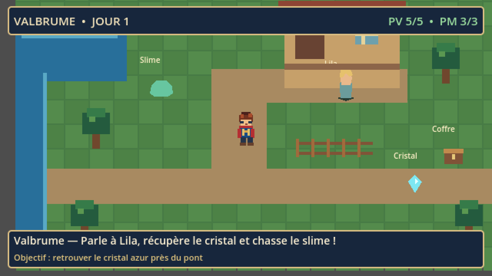
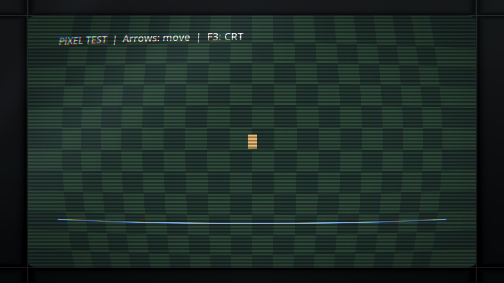

# GD RPG Engine

A modular 2D JRPG engine for Godot 4, inspired by the exploration, party-driven encounters and presentation of 32-bit-era JRPGs.

## Goals
- Top-down exploration, interactions and map transitions
- Data-driven actors, items, skills and encounters
- Dialogue and event sequencing
- Active Time Battle (ATB) combat foundation
- Pixel-perfect 2D presentation with optional CRT effects
- Editor-friendly GDScript resources and plugin tooling

## Requirements
- Godot 4.4.1 (GDScript, no third-party runtime dependencies)

## Run
Open this repository in Godot and run the project (F6/F5). The main demo is asset-free.

The game renders into a dedicated **640×360 SubViewport**, which is enlarged with nearest-neighbor filtering to a native **1920×1080 (Full HD, 16:9)** window. The CRT shader is a separate final pass on the native-resolution root viewport, so curvature, scanlines, RGB phosphor grille, vignette and chromatic aberration are evaluated at **1080p**, after the pixel-art image has been enlarged. F3 toggles this final pass. A dedicated pixel-grid test scene is available at `examples/pixel_test/pixel_test.tscn`.

## Screenshots

The following captures are generated by the **Visual screenshots** GitHub Actions workflow at 1920×1080. Each scene is captured with the CRT overlay disabled and enabled.

| Demo | Demo with CRT |
|:---:|:---:|
|  |  |
| **Pixel test** | **Pixel test with CRT** |
|  |  |

The PNG files are committed under [docs/screenshots](docs/screenshots/) so they are visible directly in the repository. The workflow also publishes a downloadable `gd-rpg-1080p-screenshots` artifact for each run (14-day retention). Captures use a virtual X display; they validate the rendered output at the target resolution, but are not a substitute for checking on physical displays.

The final display pass now draws a permanent graphite CRT housing with a molded bevel, rounded inset glass and soft specular highlights. Its glass and housing reflections sample the live game framebuffer every frame, so reflected colors follow gameplay rather than using a static texture. F3 toggles the phosphor effects independently: barrel curvature, rounded screen corners, scanlines, RGB grille, vignette, chromatic aberration and restrained glow. The housing and live reflections remain visible in clean mode. It runs as a final full-screen `ColorRect` pass in the 1920×1080 output viewport, after a full-screen `TextureRect` has scaled the fixed 640×360 `SubViewport` with nearest-neighbor filtering. `RPGDisplayRoot` owns this presentation pipeline and keeps game content isolated in its internal viewport. `RPGCRTOverlay` exposes the effect strength and each visual parameter, with `clean`, `crt` and `crt_strong` presets; F3 toggles the effect in both examples. The clean image remains available by disabling the overlay. The shader's screen texture is sampled at output resolution, while the source image retains nearest-neighbor scaling.

## World and camera foundations

- Extend `RPGMap` for reusable map scenes. Add `Marker2D` nodes below a `SpawnPoints` child and name them (the default marker is `default`).
- Use `get_spawn_position(&"spawn_name")` to resolve a named entry point; unknown names fall back to the map's `default_spawn`.
- Use `RPGPixelCamera` as a `Camera2D` child of the player. It offsets the camera view to whole virtual pixels without mutating the camera's world transform, avoiding subpixel camera movement.
- The demo is itself an `RPGMap`, uses a named default spawn, and demonstrates the pixel camera.

The map base and camera are foundations: TileMapLayer composition, camera limits and map transitions are still planned.

## Layout
- `addons/gd_rpg/runtime`: reusable runtime systems, including display, character, dialogue, interaction and world foundations
- `addons/gd_rpg/data`: typed Resource definitions
- `addons/gd_rpg/ui`: reusable UI
- `addons/gd_rpg/editor`: editor integration
- `examples/demo`: playable systems showcase
- `examples/pixel_test`: pixel-grid test content and native-resolution CRT presentation scene
- `addons/gd_rpg/runtime/display`: reusable internal-resolution viewport and final-output CRT presentation
- `tests`: automated headless checks

See [ROADMAP.md](ROADMAP.md) for the implementation plan and remaining work.
