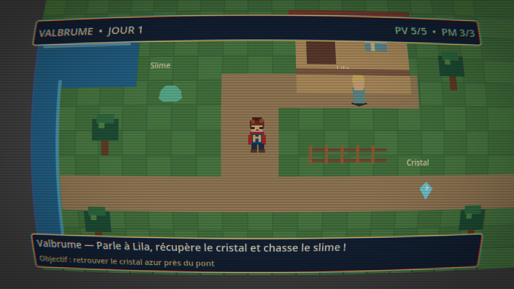
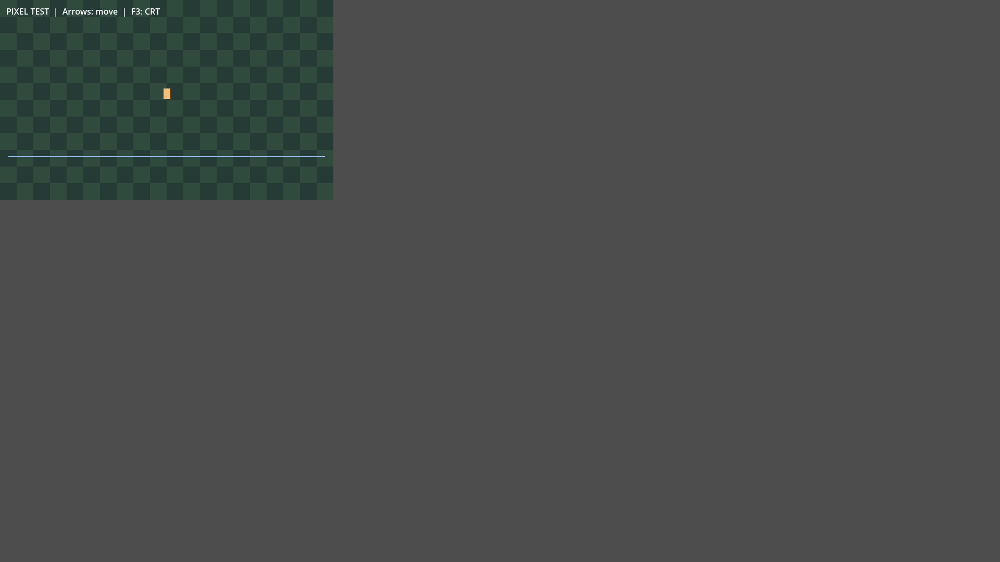

# GD RPG Engine

A modular 2D JRPG engine for Godot 4, inspired by the exploration, party-driven encounters and presentation of 32-bit-era JRPGs.

## Goals
- Top-down exploration, interactions and map transitions
- Data-driven actors, items, skills and encounters
- Dialogue and event sequencing
- Active Time Battle (ATB) combat foundation
- Pixel-perfect 2D presentation with optional CRT effects
- Editor-friendly GDScript resources and plugin tooling

## Requirements
- Godot 4.4.1 (GDScript, no third-party runtime dependencies)

## Run
Open this repository in Godot and run the project (F6/F5). The main demo includes an original pixel-art hero sprite and a short playable quest.

The game renders into a dedicated **640×360 SubViewport**, which is enlarged with nearest-neighbor filtering to a native **1920×1080 (Full HD, 16:9)** window. The CRT shader is a separate final pass on the native-resolution root viewport, so curvature, scanlines, RGB phosphor grille, vignette and chromatic aberration are evaluated at **1080p**, after the pixel-art image has been enlarged. F3 toggles this final pass. A dedicated pixel-grid test scene is available at `examples/pixel_test/pixel_test.tscn`.

## Linux AppImage

The latest Linux x86_64 AppImage is committed at [dist/GD-RPG-x86_64.AppImage](dist/GD-RPG-x86_64.AppImage) (use **Download raw file** on GitHub). The AppImage workflow rebuilds and updates this file after a successful smoke test.

A Linux AppImage is built automatically by GitHub Actions on every push to `main`, on version tags (`v*`) and on manual runs. The artifact is named `gd-rpg-linux-appimage` and contains the exported game and its bundled runtime libraries.

Download the artifact from the [Linux AppImage workflow](https://github.com/cgreg21/gd-rpg/actions/workflows/appimage.yml), extract the ZIP, then run:

```bash
chmod +x GD-RPG-x86_64.AppImage
./GD-RPG-x86_64.AppImage
```

The workflow exports with Godot 4.4.1, assembles the AppImage with linuxdeploy, and performs a headless startup smoke test before publishing the artifact. This is an x86_64 Linux build.

## Screenshots

The following captures are generated by the **Visual screenshots** GitHub Actions workflow at 1920×1080. Each scene is captured with the CRT overlay disabled and enabled.

| Demo | Demo with CRT |
|:---:|:---:|
|  |  |
| **Pixel test** | **Pixel test with CRT** |
|  |  |

The PNG files are committed under [docs/screenshots](docs/screenshots/) so they are visible directly in the repository. The workflow also publishes a downloadable `gd-rpg-1080p-screenshots` artifact for each run (14-day retention). Captures use a virtual X display; they validate the rendered output at the target resolution, but are not a substitute for checking on physical displays.

The final display pass is a borderless full-screen CRT effect. F3 toggles curvature, scanlines, RGB grille, vignette, chromatic aberration and restrained glow; disabling it restores the clean pixel-perfect image without any frame or decorative border.

## Playable demo — Valbrume

The reusable inventory uses `RPGItemData` Resources and an `RPGInventory` node for stack limits, quantities, additions and removals. Valbrume starts with one Potion (3 PV); command 3 consumes it from the inventory. A nearby treasure chest grants 10 G and a unique Old Key. The key unlocks the sanctuary door, consumes itself and grants 20 G; both rewards are one-time only. Headless tests cover stacking limits, item listing and the one-time reward.

Unlock the sanctuary after opening the chest to complete the extended village objective. Valbrume supports a versioned JSON save in `user://valbrume_save.json`; F5 saves and F9 restores the player position, stats, inventory and quest progress. Saves are restricted to exploration, outside menus and battles. The demo is a compact JRPG slice with a 16/32-bit fantasy direction: a cliffside village, warm stone paths, timber house, river, lush greenery, a named NPC, a collectible crystal and a slime encounter. The original hero has front/back/left/right walk animations.

- **Move:** arrow keys
- **Inventory:** I (close with I or Échap)\n- **Treasure chest:** E near the chest
- **Interact / collect:** E
- **Battle commands:** 1 Attack, 2 Azure Spark, 3 Potion, 4 Defend (E/Enter also attacks)
- **Advance dialogue:** Enter
- **Toggle CRT:** F3

Talk to Lila, collect the azurite crystal near the bridge, then defeat the slime on the path. The encounter demonstrates a small command menu, MP-consuming skill, healing potion, defensive stance and enemy counterattacks. Defeating the slime awards 20 EXP and 15 G, and unlocks Lila's closing dialogue. The reusable `RPGATBBattle` node is available at `addons/gd_rpg/runtime/battle/atb_battle.gd`: it manages per-battler charge rates, ready states and explicit turn consumption. See its headless coverage in `tests/test_atb.gd`.

## World and camera foundations

- Extend `RPGMap` for reusable map scenes. Add `Marker2D` nodes below a `SpawnPoints` child and name them (the default marker is `default`).
- Use `get_spawn_position(&"spawn_name")` to resolve a named entry point; unknown names fall back to the map's `default_spawn`.
- Use `RPGPixelCamera` as a `Camera2D` child of the player. It offsets the camera view to whole virtual pixels without mutating the camera's world transform, avoiding subpixel camera movement.
- The demo is itself an `RPGMap`, uses a named default spawn, and demonstrates the pixel camera.

The map base and camera are foundations: TileMapLayer composition, camera limits and map transitions are still planned.

## Layout
- `addons/gd_rpg/runtime`: reusable runtime systems, including display, character, dialogue, interaction and world foundations
- `addons/gd_rpg/data`: typed Resource definitions
- `addons/gd_rpg/ui`: reusable UI
- `addons/gd_rpg/editor`: editor integration
- `examples/demo`: playable Valbrume village quest with an original animated hero, NPC dialogue, collectible crystal and slime encounter
- `examples/pixel_test`: pixel-grid test content and native-resolution CRT presentation scene
- `addons/gd_rpg/runtime/display`: reusable internal-resolution viewport and final-output CRT presentation
- `tests`: automated headless checks

See [ROADMAP.md](ROADMAP.md) for the implementation plan and remaining work.
